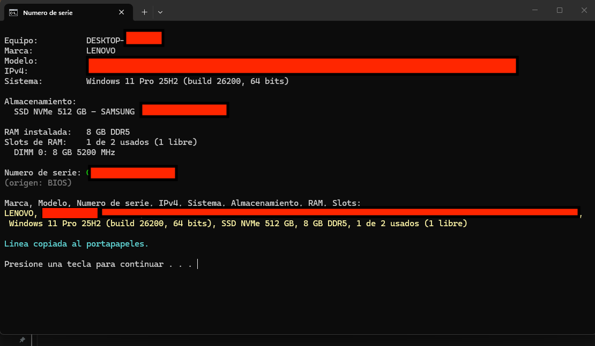

# info_PC

> Antes llamado `Numero de serie.bat`.

Inventario rápido de un equipo Windows **con doble clic y sin instalar nada**.

Un solo archivo `.bat` de pocos KB, con un script de PowerShell embebido, que consulta a Windows (WMI) y muestra en segundos los datos que normalmente hay que buscar a mano o con utilidades pesadas.

## Qué muestra

| Dato | Detalle |
|---|---|
| Equipo | Nombre del PC |
| Marca y modelo | Fabricante y modelo del equipo |
| Número de serie | Desde la BIOS; si trae un valor de relleno (`Default`, `O.E.M.`, `System Serial Number`…), lo busca en la placa base |
| IPv4 | Prioriza el adaptador con puerta de enlace (el que tiene salida a la red) |
| Sistema operativo | Edición, versión (ej. 25H2), build y arquitectura |
| Almacenamiento | Distingue HDD, SSD y SSD NVMe, con capacidad y modelo (excluye USB) |
| RAM | Total instalado, tipo (DDR3/DDR4/DDR5), velocidad por módulo y slots libres |

Al final arma una **línea con todos los datos separados por comas** y la **copia al portapapeles**, lista para pegar en una planilla de inventario.

## Uso

1. Descarga `info_PC.bat`.
2. Haz doble clic.
3. Pega (Ctrl+V) la línea en tu planilla.

No requiere permisos de administrador, internet ni instalación.

## Compatibilidad

Funciona en **Windows 7, 10 y 11**. Windows 7 trae PowerShell 2.0, por lo que el script evita comandos modernos:

- Usa `Get-WmiObject` en vez de `Get-CimInstance`, `Get-NetIPAddress` o `Get-PhysicalDisk`.
- Para el tipo de disco usa `MSFT_PhysicalDisk` (Windows 8+); en Windows 7, donde no existe, marca como SSD solo si el modelo lo indica.
- Para copiar usa `Set-Clipboard` si existe (PowerShell 5+) y, si no, `clip.exe`.

## Cómo funciona

El `.bat` llama a PowerShell, que lee el propio archivo y ejecuta todo lo que viene después de la marca `#PSSTART`. Así se mantiene un único archivo fácil de llevar en un pendrive, sin tener que habilitar la ejecución de scripts `.ps1` en el equipo.

## Licencia

[MIT](LICENSE) © 2025 Carlos Alarcón Lagos
